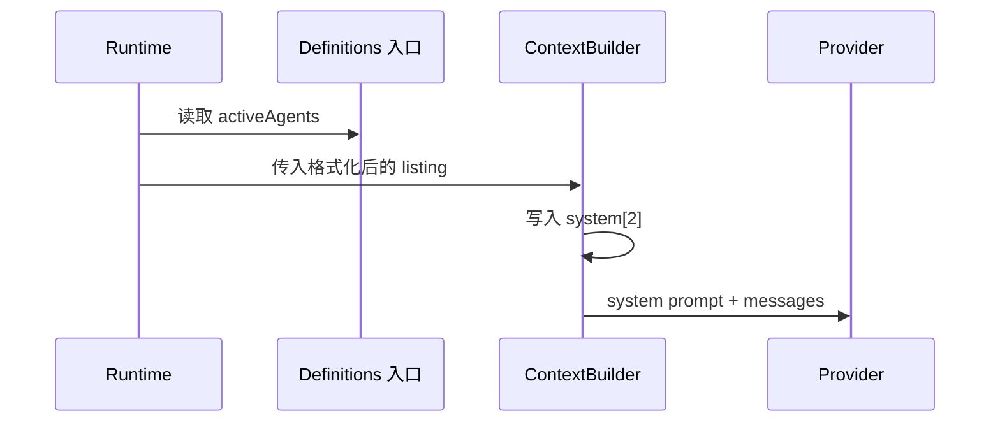

# Agent listing in the system prompt

## 行为与边界

Agent 工具 description 指向 system prompt 中的可用类型目录。Runtime 在每轮构建
context 时，从 `AgentDefinitionsSnapshot.activeAgents` 生成完整 listing，放进
`system[2]` 的 dynamic system body；不再生成 `agent_listing_delta` attachment，
也不把目录写进会话历史。

`AgentDefinitionsSnapshot.activeAgents` 是已归一化的有效目录。Runtime 通过依赖注入的
同步、无 I/O `getAgentDefinitions()` 读取；默认入口使用启动期 profiles 的归一化快照。
本地集成入口在新父 turn 开始时加载并固定快照，listing、runner 和 plugin-reference 共用该定义。
同轮后续请求不重新读取；下一轮按新的 definitions 重建 system prompt，因此名称、描述、
工具或模型变化会自然反映，不会追加历史提醒。

Agent 工具不可用时（工具表没有 `Agent`）不生成 listing。Agent description 的文案固定为
first-party MCS 分支的 lean 版本；并发提示附在 listing 末尾。定义来源句式保持
``Each agent type's model, reasoning effort, and tools come from its definition (`.nekode/agents/*.md` frontmatter).``

## 事实与时序

唯一事实是当前 turn 的 `activeAgents`。listing 是 system prompt 的一部分，不参与
attachment 去重、compact 重述或冷恢复；会话恢复后由下一次 context 构建重新生成。
构建失败向上抛出，不解释为空目录。

